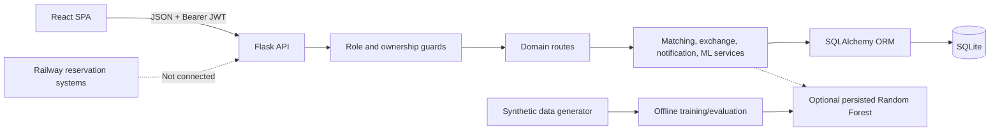

# RailSwap AI

RailSwap AI is a consent-first railway berth-exchange recommendation prototype. A passenger records a synthetic booking and a berth preference, the application finds **mutual** matches on the same journey, explains why each pair is compatible, and supports an application-level exchange workflow with notifications and an explicitly simulated authorization gate.

> **Important:** This is an academic demonstration using synthetic passengers, trains, berths, bookings, and verification. It is not affiliated with Indian Railways or any railway operator. It does not create, verify, transfer, or cancel real reservations. An accepted request is not official railway authorization.

## Highlights

- Reciprocal matching: both passengers must want the other passenger's current berth type.
- Deterministic hard-eligibility rules applied before scoring; ML never overrides eligibility.
- Transparent 0-100 ranking score with per-factor contributions and human-readable explanations.
- Optional Random Forest confidence trained offline on synthetic compatibility labels.
- Application-level consent workflow with guarded state transitions and audit events.
- Privacy controls: display-name sharing preference, redacted administrator views, non-sensitive export.
- Navy, ivory, and blue React interface with a public landing page, dashboards, train discovery, berth maps, matching, exchanges, notifications, ML lab, and admin console.
- Reproducible backend and frontend tests.

## Technology

| Layer | Technology |
|---|---|
| Backend | Python 3.14, Flask 3, Flask-SQLAlchemy, Flask-JWT-Extended, Flask-Cors, Flask-Migrate |
| Database | SQLite for local demonstration; SQLAlchemy 2 ORM |
| Validation/security | Werkzeug password hashing, JWT bearer tokens, ownership and role guards |
| ML experiment | pandas, NumPy, scikit-learn Random Forest, joblib |
| Frontend | React 18, React Router 6, Vite 6, Recharts, Lucide icons, custom CSS |
| Tests | pytest, Vitest, Testing Library, jsdom |

## Architecture



The backend enforces all business decisions. The frontend is a client of the documented JSON API and does not duplicate eligibility logic as an authority. More diagrams are available in [`docs/diagrams/`](docs/diagrams/).

## Run locally

### Prerequisites

- Python 3.11+ (tested with Python 3.14)
- Node.js 20+ with npm
- Git, only if you need to clone the repository

No `.bat` or PowerShell helper script is required. Run the commands below from the repository root.

### 1. Clone the repository

```text
git clone https://github.com/Shreyashg07/RailSwap-AI-Intelligent-Railway-Seat-Exchange.git
cd RailSwap-AI-Intelligent-Railway-Seat-Exchange
```

If the project is already on your computer, open a terminal in the project root and skip this step.

### 2. Install dependencies and seed data

The commands below use the Windows virtual-environment layout. On macOS/Linux, use `.venv/bin/python` and `cp` instead.

```text
python -m venv .venv
.venv\Scripts\python.exe -m pip install -r backend\requirements.txt
copy .env.example .env
.venv\Scripts\python.exe -m backend.seed --reset
npm --prefix frontend/frontend install
```

`.env` is local configuration and must not be committed. The seed command creates the synthetic demonstration database.

Activating the virtual environment is optional. The commands above invoke `.venv\Scripts\python.exe` directly, so they work in PowerShell, Command Prompt, or VS Code without a setup script.

### 3. Start the application

Open two terminals in the project root.

Terminal 1, backend:

```text
.venv\Scripts\python.exe -m backend.app
```

Terminal 2, frontend:

```text
npm --prefix frontend/frontend run dev
```

Open <http://localhost:5173>. The API health endpoint is <http://127.0.0.1:5000/api/health>.

Do not run `backend/app.py` directly; package-relative imports require `python -m backend.app` from the project root.

### Common commands

Run the clone command from the folder where you want the project; run the remaining commands from the project root.

| Command | Purpose |
|---|---|
| `git clone https://github.com/Shreyashg07/RailSwap-AI-Intelligent-Railway-Seat-Exchange.git` | Download the full project from GitHub |
| `cd RailSwap-AI-Intelligent-Railway-Seat-Exchange` | Enter the cloned project folder |
| `python -m venv .venv` | Create the Python virtual environment |
| `.venv\Scripts\python.exe -m pip install -r backend\requirements.txt` | Install backend dependencies |
| `copy .env.example .env` | Create local configuration from the template |
| `.venv\Scripts\python.exe -m backend.seed --reset` | Create or rebuild the synthetic demo database |
| `npm --prefix frontend/frontend install` | Install frontend dependencies |
| `.venv\Scripts\python.exe -m backend.app` | Start the backend |
| `npm --prefix frontend/frontend run dev` | Start the frontend |
| `npm test` | Run the backend and frontend test suites |
| `npm run build` | Create the production frontend build |
| `npm run seed` | Reset and reseed synthetic demonstration data |
| `npm run ml:generate` | Regenerate the synthetic ML dataset |
| `npm run ml:train` | Train the Random Forest artifact |
| `npm run ml:evaluate` | Regenerate the saved evaluation metrics |

## Demo accounts

All records are synthetic.

| Role | Email | Password |
|---|---|---|
| Administrator | `admin@railswap.demo` | `Admin@12345` |
| Passenger | `aarav@railswap.demo` | `Demo@1234` |
| Passenger | `priya@railswap.demo` | `Demo@1234` |
| Passenger | `rohan@railswap.demo` | `Demo@1234` |
| Passenger | `ananya@railswap.demo` | `Demo@1234` |
| Passenger | `vikram@railswap.demo` | `Demo@1234` |
| Passenger | `meera@railswap.demo` | `Demo@1234` |

## Guided demonstration

1. Sign in as **Rohan**. Open **Find Matches**, select his booking, and run matching. A reciprocal candidate (Ananya) is shown with a high transparent score.
2. Review the score breakdown and match details. Notice that both directions, coach scope, active-exchange exclusions, and synthetic-data limitations are displayed.
3. Create an exchange request. The recipient receives an application notification; no railway reservation changes.
4. Sign in as **Ananya**, open **Exchange Requests**, and accept or decline. Accepted means both application users agreed, not that a railway authority approved a change.
5. Sign in as **admin@railswap.demo**. The administrator sees redacted exchange summaries only. Starting or completing the authorization step is explicitly a simulation.
6. Optionally inspect **ML Lab** for actual synthetic-label metrics, feature importance, confusion matrices, and limitations.
7. Try **Aarav**. Both of his seeded bookings are already part of active exchanges, so matching correctly excludes them. This demonstrates conflict protection rather than missing data.

See [`docs/USER_GUIDE.md`](docs/USER_GUIDE.md) for a fuller walkthrough.

## Matching semantics

A candidate is eligible only when all of the following hold:

- requester and candidate are different users and different bookings;
- both bookings belong to the same journey and train;
- the journey has not passed;
- both berth records are valid;
- both bookings have simulated demo verification;
- both passengers have preferences;
- the requester prefers the candidate's current berth type;
- the candidate prefers the requester's current berth type;
- both coach scopes are satisfied;
- neither booking is already in an active exchange request.

Eligible candidates receive a deterministic ranking score:

```text
score = 50 * reciprocal_match
      + 20 * preference_compatibility
      + 15 * coach_compatibility
      + 15 * berth_proximity
```

Ties are broken by lower candidate booking ID. The score is a ranking heuristic, not a probability that a real passenger will accept.

The experimental model adds a synthetic-compatibility confidence value for information, but it cannot make an ineligible pair eligible and does not determine ranking.

## Workflow states

```text
PENDING
  -> ACCEPTED_BY_BOTH | DECLINED | CANCELLED | EXPIRED
ACCEPTED_BY_BOTH
  -> AWAITING_EXTERNAL_AUTHORIZATION | CANCELLED | EXPIRED
AWAITING_EXTERNAL_AUTHORIZATION
  -> COMPLETED | CANCELLED
```

`COMPLETED` is reachable only through the administrator's explicitly simulated authorization action. No external service is called.

## Machine learning experiment

Artifacts:

- `backend/ml/data/synthetic_pairs.csv`
- `backend/ml/saved_models/railswap_compatibility_rf.joblib`
- `backend/ml/saved_models/training_metadata.json`
- `backend/ml/saved_models/evaluation_metrics.json`

Current dataset and evaluation snapshot:

| Item | Actual value |
|---|---|
| Synthetic pairs | 4,320 |
| Compatible / incompatible | 1,590 / 2,730 |
| Train / test rows | 3,240 / 1,080 |
| Train / test groups | 270 / 90 |
| Features | 8 |
| Model | Random Forest, 240 trees, max depth 10 |
| Split | `GroupShuffleSplit`, 25% test, grouped by scenario |
| ML precision / recall / F1 | 1.0000 / 1.0000 / 1.0000 |
| Rule baseline precision / recall / F1 | 1.0000 / 1.0000 / 1.0000 |
| Precision@5, ML / baseline | 0.8289 / 0.7267 |
| Mean / p95 inference | 34.7123 ms / 42.9930 ms |

The target is generated from the same documented eligibility rules used by the deterministic engine. Perfect classification metrics therefore demonstrate implementation consistency, not real-world passenger acceptance. See [`docs/ML_METHODOLOGY.md`](docs/ML_METHODOLOGY.md).

Reproduce offline:

```text
.venv\Scripts\python.exe -m backend.ml.generate_dataset
.venv\Scripts\python.exe -m backend.ml.train_model
.venv\Scripts\python.exe -m backend.ml.evaluate_model
```

The API lazily loads a persisted artifact. It never trains during a request. If the model or pandas/joblib is unavailable, matching continues with the deterministic baseline and reports fallback status.

## Tests

```text
npm test                 # backend + frontend
npm run test:backend
npm run test:frontend
npm run build
```

Latest verified results:

- Backend: **30 passed** in 44.81 seconds.
- Frontend: **5 passed** in 2.35 seconds total run; test execution 208 ms.
- API smoke: **17/17 checks passed** across health, authentication, trains, journeys, bookings, dashboard, exchanges, notifications, ML metrics, export, admin views, and matching.
- Production build: successful. Vite reports an optional code-splitting warning for the main JavaScript chunk.

See [`docs/TESTING_REPORT.md`](docs/TESTING_REPORT.md) for coverage and limitations.

## Configuration

Copy `.env.example` to `.env`. Never commit a real `.env`.

| Variable | Purpose | Default |
|---|---|---|
| `SECRET_KEY` | Flask secret; replace outside local development | Development fallback |
| `JWT_SECRET_KEY` | JWT signing secret; replace outside local development | Development fallback |
| `JWT_ACCESS_TOKEN_HOURS` | Token lifetime | `12` |
| `DATABASE_URL` | SQLAlchemy database URL | `backend/instance/railswap.db` |
| `CORS_ORIGINS` | Allowed browser origins | Local Vite origins |
| `AUTO_CREATE_DB` | Create tables at application startup | `true` |
| `ML_MODEL_PATH` | Optional model override | Saved model artifact |
| `ML_METRICS_PATH` | Optional metrics override | Saved evaluation JSON |
| `MATCHING_RESULT_LIMIT` | Default match result count | `20` |
| `MAX_ACTIVE_MATCHES` | Reserved configuration value | `5` |

The frontend uses `/api` through Vite's proxy. To point directly at another API, set `VITE_API_BASE_URL` in `frontend/frontend/.env.local`.

## Project structure

```text
backend/
  app.py, __init__.py       Application entry point and factory
  config.py                 Environment-driven configuration
  constants.py              Domain statuses, transitions, weights
  models/                   SQLAlchemy entities and constraints
  routes/                   JSON API blueprints
  services/                 Matching, scoring, exchange, ML, notifications
  tests/                    Backend pytest suite
  ml/                       Dataset generation, training, evaluation, artifacts
  seed.py                   Idempotent synthetic demo seeder
frontend/
  frontend/                 React application root
    src/api/                API client and error handling
    src/components/         Reusable UI and workflow components
    src/context/            Authentication state
    src/pages/              Routed pages
    src/styles/             Custom global and responsive CSS
    src/tests/              Vitest tests
docs/
  PROJECT_REPORT.md         Academic project report
  API_DOCUMENTATION.md      Endpoint reference
  TESTING_REPORT.md         Test strategy and results
  USER_GUIDE.md             Demonstration and usage guide
  ML_METHODOLOGY.md         Reproducible ML methodology and caveats
  diagrams/                 Mermaid source diagrams
```

## Security and responsible-use notes

- Replace development secrets before any shared deployment.
- Use HTTPS and secure secret management outside local demonstration.
- Local JWT storage uses `localStorage`; production applications should evaluate HttpOnly cookie strategies, CSRF protection, token revocation, and refresh-token rotation.
- The API uses SQLite and is not intended for concurrent production load without a production database and migration/deployment plan.
- Administrator views intentionally redact passenger identity and booking references.
- Passengers can opt out of display-name sharing; candidate APIs use a generic public identity when disabled.
- No external railway, identity, payment, or authorization service is integrated.

## Documentation

- [Academic project report](docs/PROJECT_REPORT.md)
- [API documentation](docs/API_DOCUMENTATION.md)
- [Testing report](docs/TESTING_REPORT.md)
- [User guide](docs/USER_GUIDE.md)
- [ML methodology](docs/ML_METHODOLOGY.md)
- [Architecture diagram](docs/diagrams/architecture.mmd)
- [ER diagram](docs/diagrams/er_diagram.mmd)
- [Exchange sequence](docs/diagrams/exchange_sequence.mmd)
- [Matching flow](docs/diagrams/matching_flow.mmd)
- [State machine](docs/diagrams/exchange_state.mmd)
