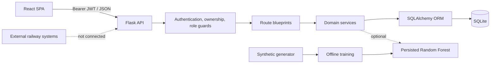
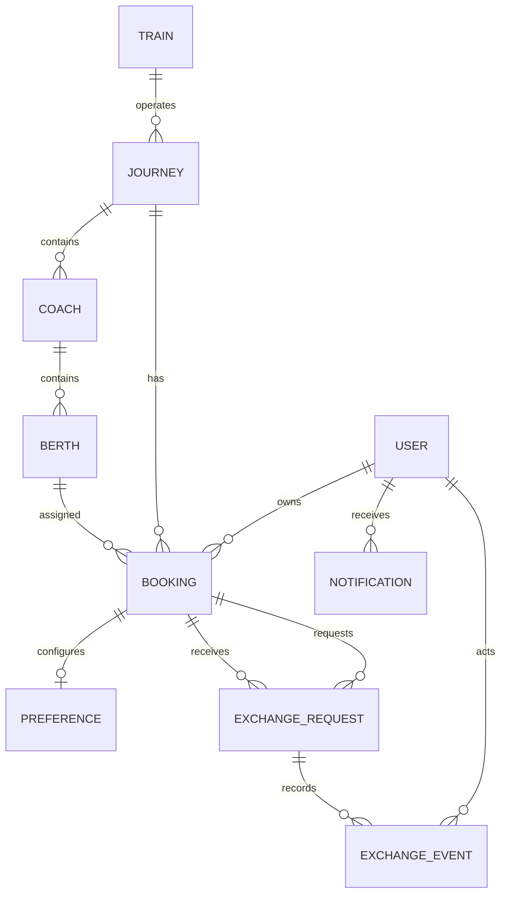
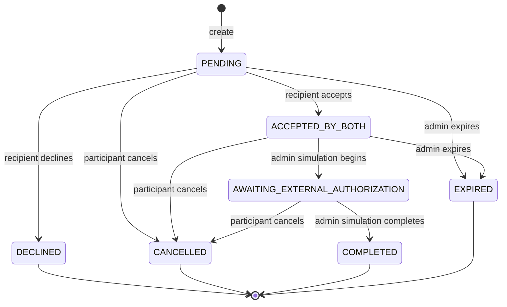

# RailSwap AI: A Consent-First Railway Berth Exchange Recommendation System with a Synthetic Machine-Learning Experiment

### A B.Tech Major Project Report

Submitted in partial fulfilment of the requirements for the degree of

**Bachelor of Technology**

in

**[Department Name]**

by

**[Student Name]**  
**[Roll Number]**

Under the guidance of

**[Project Guide Name]**

**[Institution Name]**  
**[Academic Year]**

> Replace bracketed fields with the institution's required details before submission. The implementation, results, constraints, and references in this report describe the supplied project.

---

## Declaration

I declare that this project report describes work carried out for academic purposes using synthetic demonstration data. The implementation does not use real railway reservations, tickets, passenger records, official identity data, or payment information. It is not affiliated with, endorsed by, or connected to Indian Railways or any other railway operator.

The matching workflow represents mutual application-level consent only. No exchange is an official railway authorization. The reported ML metrics are synthetic-label consistency metrics and are not evidence of real-world passenger acceptance.

**[Student Name]**  
**[Date]**

---

## Abstract

Railway passengers often have strong preferences about berth position and coach layout, but exchanging a reserved berth with another passenger is usually informal and difficult to coordinate. A useful digital exchange recommendation must satisfy two different requirements at once: a pair must be feasible under operational constraints, and both passengers must genuinely prefer the other side. A one-sided or opaque recommendation can create false expectations, privacy exposure, or unsafe workflow assumptions.

This project presents RailSwap AI, a full-stack demonstration of consent-first reciprocal berth-exchange recommendation. The backend is implemented with Flask, SQLAlchemy, SQLite, and JWT authentication. The frontend is a responsive React single-page application. A candidate is eligible only after deterministic checks covering journey identity, upcoming status, booking and berth validity, simulated verification, mutual berth preference, coach scope, self-exchange prevention, and active-request conflicts. Eligible pairs receive a transparent 0-100 weighted ranking score and a human-readable explanation. The application then supports a guarded exchange state machine, notifications, participant-scoped views, privacy controls, redacted administrator views, and a non-sensitive export.

An auxiliary Random Forest experiment is included to demonstrate a reproducible offline ML pipeline. The synthetic dataset contains 4,320 pairs, split by scenario group into 3,240 training rows and 1,080 test rows. Because labels are derived from the documented eligibility rules, both the model and the rule baseline achieve perfect classification metrics; this is explicitly interpreted as implementation consistency, not predictive validity. Precision@5 is 0.8289 for the model and 0.7267 for the baseline. The model is never used to override eligibility and is never trained during an API request. The final implementation passes 30 backend tests, 5 frontend tests, a 17-check API smoke pass, and a production frontend build.

**Keywords:** berth exchange, reciprocal recommendation, consent, explainable ranking, Flask, React, JWT, Random Forest, synthetic data

---

## Table of Contents

1. [Introduction](#1-introduction)
2. [Background and Technical Context](#2-background-and-technical-context)
3. [Requirements Analysis](#3-requirements-analysis)
4. [System Design](#4-system-design)
5. [Matching and Workflow Methodology](#5-matching-and-workflow-methodology)
6. [Machine-Learning Experiment](#6-machine-learning-experiment)
7. [Implementation](#7-implementation)
8. [Testing and Results](#8-testing-and-results)
9. [Discussion and Limitations](#9-discussion-and-limitations)
10. [Conclusion and Future Work](#10-conclusion-and-future-work)
11. [References](#11-references)
12. [Appendix A: Demo Access and Commands](#appendix-a-demo-access-and-commands)
13. [Appendix B: API Summary](#appendix-b-api-summary)

---

## 1. Introduction

### 1.1 Background

A reserved railway journey assigns a specific coach and berth. Passengers may prefer a lower berth, a side berth, a berth closer to companions, or a different coach layout. When two passengers would both be better off after swapping, a mutually beneficial exchange may exist. In practice, such an exchange is often discovered through conversation, messages, or informal coordination. This creates several problems:

- one passenger may not know whether the other is interested;
- a one-sided preference may be mistaken for a viable exchange;
- the same booking may become involved in multiple overlapping negotiations;
- personal identity or booking references may be exposed unnecessarily;
- there is no clear audit trail of who agreed to what;
- users may assume an application-level agreement changes an official reservation when it does not.

RailSwap AI is designed as a teaching prototype that explores a safer software architecture for this problem.

### 1.2 Problem statement

The task is to build a complete web application that can:

- represent synthetic journeys, berths, bookings, and berth preferences;
- identify only **reciprocal** exchange candidates;
- apply hard eligibility constraints before ranking;
- explain each recommendation and its limitations;
- support request, acceptance, decline, cancellation, and expiry;
- maintain participant privacy and administrator redaction;
- demonstrate a reproducible ML experiment without allowing an unvalidated model to control consent decisions;
- remain runnable and testable on a local Windows development machine.

The application must not imply that it can update a real railway reservation.

### 1.3 Objectives

1. Implement a secure Flask REST API with JWT authentication, ownership checks, and role-based administration.
2. Model synthetic railway data with relational constraints.
3. Implement deterministic reciprocal matching and explainable weighted scoring.
4. Prevent a booking from participating in overlapping active exchanges.
5. Implement a guarded exchange workflow and notification trail.
6. Build a responsive React interface for passengers and administrators.
7. Train and persist an auxiliary Random Forest model on synthetic pairwise data.
8. Ensure safe fallback if ML artifacts are unavailable.
9. Provide automated tests, reproducible setup scripts, and documentation.
10. Clearly communicate consent, privacy, synthetic-data, and non-official-status constraints throughout the product.

### 1.4 Scope

Included:

- user registration and login;
- profile and display-name privacy controls;
- synthetic train, journey, coach, berth, and booking browsing;
- demo booking creation and removal;
- one berth preference per booking;
- same-journey reciprocal matching;
- score breakdowns and eligibility explanations;
- application-level exchange requests and state transitions;
- notifications and unread counts;
- aggregate passenger dashboard;
- ML experiment report and model status;
- redacted administrator overview and simulated authorization controls;
- non-sensitive JSON export;
- local setup, tests, and documentation.

Excluded by design:

- real railway reservation integration;
- PNR or ticket verification;
- payments, refunds, or fare differences;
- identity verification;
- real personal data;
- automatic completion of a railway seat change;
- production deployment, email delivery, SMS, MFA, or password recovery;
- cross-journey or multi-party exchanges;
- dynamic seat pricing or inventory optimization.

### 1.5 Contributions

- A complete, runnable full-stack prototype rather than a static mock-up.
- A mutual-consent eligibility policy implemented server-side.
- A transparent weighted ranking method with per-factor explanations.
- A state machine that separates application consent from a simulated external authorization gate.
- Privacy controls and administrator redaction.
- A reproducible synthetic ML pipeline with explicit anti-overclaiming documentation.
- A test suite covering authentication, ownership, reciprocal matching, conflict handling, state transitions, privacy, export, and ML fallback.

---

## 2. Background and Technical Context

### 2.1 Recommendation under hard constraints

General recommender systems often rank items by predicted relevance. A berth exchange is more constrained. The candidate must be on the same journey, must have a compatible booking, and must prefer the requester's berth while the requester prefers the candidate's berth. These are feasibility conditions, not soft ranking signals.

This project therefore separates the problem into:

1. **eligibility**, a deterministic all-or-nothing decision;
2. **ranking**, a heuristic ordering among eligible pairs;
3. **explanation**, a presentation of reasons and limitations;
4. **workflow**, a stateful consent process that is separate from recommendation.

This separation is a central design decision. It prevents a high score from compensating for a failed safety rule and prevents a model from manufacturing eligibility.

### 2.2 JWT authentication

JSON Web Tokens provide a compact bearer-token format for API authentication. The backend uses Flask-JWT-Extended to create short-lived access tokens and load the current user from the token subject. The API validates token presence, format, expiry, and user existence. Object-level authorization is then applied to bookings, preferences, notifications, and exchanges. Role checks are applied to administrator endpoints.

JWT authentication does not solve every security problem. This demonstration stores the token in browser `localStorage` for simplicity. A production design would need to consider HttpOnly cookies, CSRF, token revocation, refresh rotation, secure secret management, HTTPS, rate limiting, and account recovery.

### 2.3 Relational data and constraints

SQLAlchemy models enforce structure and several invariants at the database boundary:

- unique user email;
- unique train number;
- unique coach number within a journey;
- unique berth number within a coach;
- unique berth per journey through the booking constraint;
- one preference per booking;
- distinct requester/recipient bookings;
- allowed exchange statuses;
- score range 0-100;
- valid role, berth type, coach scope, and verification status enumerations.

Some policies require application logic rather than a simple database constraint, such as mutual preference, active-exchange conflicts, ownership, and valid state transitions.

### 2.4 Single-page application architecture

The React frontend routes between authentication, passenger, ML, and administrator areas. It centralizes API access and token handling in a client module, maintains authentication state in a context provider, and protects routes by login and role.

The interface uses a navy, ivory, and blue visual language, custom responsive CSS, accessible buttons and progress bars, loading states, empty states, error states, and explicit notices. It intentionally avoids presenting the score as a probability.

### 2.5 Responsible use of ML

The ML experiment is included as an engineering artifact, not as a source of authority. The target is generated from documented rules. A model trained on such labels can reproduce those rules well, but that does not establish real-world acceptance prediction. The report therefore emphasizes:

- synthetic-label circularity;
- grouped splitting;
- the difference between classification and real decision usefulness;
- safe fallback;
- the absence of request-time training;
- the continued authority of deterministic eligibility.

---

## 3. Requirements Analysis

### 3.1 Actors

| Actor | Responsibilities |
|---|---|
| Passenger | Manage own bookings and preference, search matches, request/respond/cancel exchanges, view notifications, control display-name sharing |
| Administrator | View aggregate system state, inspect redacted exchange states, advance only explicitly simulated authorization transitions |
| System | Enforce eligibility, ownership, privacy, state transitions, notifications, fallback, and data-mode notices |

### 3.2 Functional requirements

#### Authentication and profile

- FR-1: Register a passenger with a unique email and a hashed password.
- FR-2: Log in and receive a bearer token.
- FR-3: Read and update the current profile.
- FR-4: Change password only after checking the current password.
- FR-5: Allow a passenger to opt out of display-name sharing.

#### Train and booking data

- FR-6: Browse synthetic trains and upcoming journeys.
- FR-7: View coaches, berths, availability, and the current user's own booking on a journey.
- FR-8: Create a synthetic booking for an available berth.
- FR-9: Change or remove an owned booking subject to conflict and history constraints.
- FR-10: Prevent two bookings from occupying the same berth on a journey.

#### Preferences

- FR-11: Create one preference per booking.
- FR-12: Choose a desired berth type and either `ANY` or `SAME_COACH` scope.
- FR-13: Update preferences except while the booking is in an active exchange.

#### Matching

- FR-14: Require a preference before searching.
- FR-15: Search only within the same journey.
- FR-16: Require mutual berth preference.
- FR-17: Enforce both coach scopes.
- FR-18: Exclude self, invalid, expired, unverified, or active-exchange pairs.
- FR-19: Rank eligible pairs deterministically.
- FR-20: Return a score breakdown, eligibility checks, and limitations.
- FR-21: Expose only a public candidate identity.

#### Exchange workflow

- FR-22: Create a request from the requester's own booking only.
- FR-23: Re-check eligibility when creating the request.
- FR-24: Prevent overlapping active requests.
- FR-25: Allow the intended recipient to accept or decline.
- FR-26: Allow either participant to cancel an active request.
- FR-27: Record events for creation, acceptance, decline, cancellation, simulated authorization, completion, and expiry.
- FR-28: Notify affected participants.
- FR-29: Permit only documented state transitions.
- FR-30: Keep `official_change` false throughout.

#### Notification, analytics, and export

- FR-31: List notifications, unread counts, and mark-read actions.
- FR-32: Provide passenger-scoped dashboard statistics.
- FR-33: Provide model status and saved evaluation metrics.
- FR-34: Export a non-sensitive exchange summary.

#### Administration

- FR-35: Restrict admin endpoints to role `admin`.
- FR-36: Redact passenger identity and references from admin exchange data.
- FR-37: Allow only the explicitly simulated authorization transitions.

### 3.3 Non-functional requirements

| Requirement | Design response |
|---|---|
| Security | Password hashing, JWT validation, object-level ownership, role guards, no secrets returned |
| Privacy | Public identities, display-name opt-out, redacted admin data, limited export |
| Correctness | Hard rules, database constraints, conditional status updates |
| Explainability | Score contributions, eligibility checks, limitation notices |
| Reliability | ML fallback, error envelope, transactional commits |
| Usability | Responsive UI, clear labels, loading/empty/error states, guided notices |
| Maintainability | Route/service/model separation, documented modules, custom design tokens |
| Reproducibility | Seeded synthetic data, fixed ML seed, setup scripts, documented commands |
| Portability | Local SQLite, environment configuration, standard Python/Node toolchain |

### 3.4 Constraints and assumptions

- The project is demonstrated locally on Windows.
- The database is SQLite and suits a single-user demonstration, not production concurrency.
- Verifications are marked `SIMULATED_VERIFIED`.
- Data is synthetic and reproducible.
- A real railway integration is outside the project boundary.
- ML metrics are not evidence of real-world acceptance.
- The admin authorization action is a simulation and does not contact a railway system.

---

## 4. System Design

### 4.1 High-level architecture



The API is the authority for eligibility and state. The frontend presents results and sends user actions but cannot grant itself eligibility.

### 4.2 Backend layers

| Layer | Responsibility | Examples |
|---|---|---|
| Application factory | Config, extensions, blueprints, error handlers, health | `backend/__init__.py` |
| Routes | HTTP parsing, status codes, response shaping | `backend/routes/` |
| Services | Matching, scoring, exchange transitions, notifications, ML | `backend/services/` |
| Models | Entities, relationships, database constraints | `backend/models/` |
| Security | Ownership/role helpers | `backend/security.py` |
| Validation | JSON, string, email, integer checks | `backend/validation.py` |
| ML | Dataset, training, evaluation, feature schema | `backend/ml/` |
| Seed | Synthetic demonstration state | `backend/seed.py` |

### 4.3 Frontend architecture

| Area | Responsibility |
|---|---|
| `api/client.js` | Token handling, requests, errors, export |
| `context/AuthContext.jsx` | Login state and profile |
| `components/ProtectedRoute.jsx` | Authentication and admin route guards |
| `components/` | Match card, score breakdown, berth map, preference editor, notifications, sidebar, navbar |
| `pages/` | Dashboard, trains, bookings, matching, preferences, exchanges, notifications, profile, ML Lab, admin |
| `styles/` | Global design system and responsive layout |
| `tests/` | Component and utility tests |

### 4.4 Database design



Important constraints:

- a booking is unique for a `(journey, berth)` pair;
- a preference is unique for a booking;
- exchange requester and recipient bookings must differ;
- scores must lie between 0 and 100;
- only the enumerated exchange statuses are allowed;
- foreign-key enforcement is enabled for SQLite;
- exchange events preserve workflow history.

### 4.5 API design

The API uses nouns, HTTP methods, consistent JSON errors, and status-specific error codes. The detailed contract is in `docs/API_DOCUMENTATION.md`. Key design choices include:

- `401` for authentication failure and `403` for authorization failure;
- `409` for state/conflict errors;
- `422` for ineligible exchange candidates;
- candidate payloads excluding email and booking references;
- admin payloads excluding all passenger identity;
- explicit `official_change: false` and synthetic-data notices;
- exports returning an attachment with limited fields.

### 4.6 Security design

| Threat | Mitigation |
|---|---|
| Password disclosure | Werkzeug password hashing; hash never serialized |
| Unauthorized booking access | Ownership check on every private booking route |
| Unauthorized exchange access | Participant check |
| Admin impersonation | JWT identity plus role check |
| Admin privacy bypass | Admin blocked by booking ownership and admin summaries redacted |
| Self-exchange | Explicit rejection |
| Double-booking a berth | Database unique constraint plus conflict handling |
| Overlapping exchanges | Active-status query and create-time conflict check |
| Invalid workflow transitions | Allowed-transition table and conditional database updates |
| Request-time model training | Persisted artifact only; test asserts no `fit` |
| Unsafe ML failure | Fallback to deterministic matching |
| Oversized request body | 1 MiB application limit |
| CORS abuse | Configured allowed origins |

The demonstration does not include rate limiting, MFA, email verification, token revocation, or production secret management.

### 4.7 Privacy design

- Candidate names use `public_identity()`.
- A passenger can hide the display name.
- Booking references appear only in the owner's booking payloads.
- The administrator sees aggregate counts and redacted exchange summaries.
- The export excludes identity and ticket data.
- The UI consistently states that no railway system is modified.

---

## 5. Matching and Workflow Methodology

### 5.1 Hard eligibility

Given requester booking \(R\) and candidate booking \(C\), all checks must pass:

1. both bookings exist;
2. bookings are distinct;
3. users are distinct;
4. same journey and train;
5. journey date is today or later;
6. both berth records are valid;
7. both bookings have simulated verification;
8. both preferences exist;
9. requester prefers \(C\)'s current berth type;
10. candidate prefers \(R\)'s current berth type;
11. requester's coach scope permits the coach relationship;
12. candidate's coach scope permits it;
13. requester is not in an active exchange;
14. candidate is not in an active exchange.

Eligibility is `all(check.passed)`. Failure codes and human-readable reasons are retained for explanation endpoints and rejected create requests.

### 5.2 Feature construction

Let directional satisfaction be:

```text
sat(current_type, desired_type) = 1 if current_type == desired_type else 0
```

Preference compatibility:

```text
preference_compatibility =
    (sat(C.current_berth, R.desired_berth)
     + sat(R.current_berth, C.desired_berth)) / 2
```

Coach compatibility:

```text
1.00 when both bookings are in the same coach
0.65 when they are in different coaches
```

Berth proximity:

```text
distance = abs(R.berth_number - C.berth_number)
max_berths = max(R.coach.berth_count, C.coach.berth_count, 1)
proximity = 1 - distance / max_berths
proximity = proximity * 0.5 when coaches differ
```

The other features are binary: same journey, reciprocal match, valid berth pair, active journey, and scope satisfaction.

### 5.3 Weighted baseline score

```text
score = 100 * (
    0.50 * reciprocal_match
  + 0.20 * preference_compatibility
  + 0.15 * coach_compatibility
  + 0.15 * berth_proximity
)
```

The result is rounded to two decimals and displayed on a 0-100 ranking scale. Weights are illustrative configuration values, not learned or validated probabilities.

The score is intentionally **not** described as a probability. A score of 96.88 does not mean a 96.88% chance of passenger acceptance.

### 5.4 Ranking

Eligible candidates are sorted by:

1. weighted score, descending;
2. candidate booking ID, ascending.

The second key ensures deterministic output when scores tie. This behavior is covered by tests.

### 5.5 Explanation

For each candidate, the API returns:

- eligibility checks with pass/fail and detail;
- reciprocal and scope summary flags;
- score contributions with feature, label, value, weight, points;
- a narrative summary;
- ML confidence and status;
- limitations.

The explanation is generated from the same feature and eligibility objects used for ranking, reducing the risk of display logic disagreeing with the engine.

### 5.6 Exchange state machine



The state update uses a conditional `UPDATE ... WHERE status = current_status`; if zero rows change, a conflict is returned. This reduces lost-update behavior compared with an unchecked read-modify-write.

### 5.7 Consent semantics

The workflow deliberately distinguishes:

- **application consent:** two passengers agreed inside the prototype;
- **external authorization:** a railway operator's real process.

Only an explicit administrator simulation can move an accepted request to `AWAITING_EXTERNAL_AUTHORIZATION` and then `COMPLETED`. Even then, the response shows `official_change: false`, and notifications repeat that no real reservation changed.

### 5.8 Why overlap prevention matters

Without conflict prevention, one booking could promise its berth to multiple people. A single active-exchange rule ensures that a booking cannot be involved in more than one active workflow. Declined, cancelled, completed, and expired states are terminal and release the booking from the active set. Tests verify that a new request can be created after a terminal state when the pair is otherwise eligible.

---

## 6. Machine-Learning Experiment

### 6.1 Role of ML in the system

The model predicts a synthetic compatibility label. It does not:

- decide eligibility;
- modify the deterministic score;
- change ranking;
- predict real acceptance;
- authorize a reservation change.

The UI exposes it as an experimental confidence. The deterministic engine continues to work if the artifact is absent.

### 6.2 Dataset generation

`backend/ml/generate_dataset.py` creates:

- 360 synthetic journey scenario groups;
- 12 candidate pairs per group;
- 4,320 total rows;
- 1,590 compatible and 2,730 incompatible labels;
- eight 0-1 features;
- `pair_id`, `group_id`, and `pair_in_group` metadata.

The deterministic random seed is 42.

### 6.3 Target definition

The target is 1 when all synthetic hard-eligibility conditions hold:

```text
same_journey
AND reciprocal_match
AND preference_compatibility >= 0.60
AND coach_compatibility >= 0.50
AND valid_berth_pair
AND journey_active
AND scope_satisfied
```

This is not observed acceptance. It is a rule-derived label created for pipeline demonstration.

### 6.4 Split and leakage control

`GroupShuffleSplit` separates 75% of scenario groups for training and 25% for testing:

- 3,240 train rows from 270 groups;
- 1,080 test rows from 90 groups.

Scenario-aware splitting prevents near-related pairs from being distributed across both partitions. It does not remove the deeper circularity created by deriving labels from the same features.

### 6.5 Pipeline

```text
SimpleImputer(median)
  -> RandomForestClassifier(
       240 trees,
       max_depth=10,
       min_samples_leaf=3,
       class_weight="balanced",
       random_state=42,
       n_jobs=1
     )
```

The persisted artifact stores the pipeline, ordered feature names, schema version, and training metadata. The application validates the feature order before accepting the model.

### 6.6 Results

| Metric | ML | Rule baseline |
|---|---:|---:|
| Accuracy | 1.0000 | 1.0000 |
| Precision | 1.0000 | 1.0000 |
| Recall | 1.0000 | 1.0000 |
| F1 | 1.0000 | 1.0000 |
| Precision@5 | 0.8289 | 0.7267 |

Confusion matrix for both:

```text
TN = 670, FP = 0
FN = 0,   TP = 410
```

Inference over 300 single-row calls after warm-up:

- mean 34.7123 ms;
- median 33.7868 ms;
- p95 42.9930 ms.

Top feature importances:

| Feature | Importance |
|---|---:|
| `preference_compatibility` | 0.3300 |
| `reciprocal_match` | 0.2841 |
| `coach_compatibility` | 0.1520 |
| `same_journey` | 0.1013 |
| `journey_active` | 0.0503 |
| `scope_satisfied` | 0.0479 |
| `valid_berth_pair` | 0.0317 |
| `berth_proximity` | 0.0027 |

### 6.7 Interpretation

Perfect classification is expected because the target is a deterministic function of the features. The result validates that the feature pipeline, grouped split, model serialization, and runtime loading behave consistently. It does not demonstrate generalization to real passengers.

Precision@5 differs because the model ranks by predicted probability while the baseline uses hand-configured weights. The +0.1022 difference is specific to this synthetic generator and should not be presented as operational improvement.

### 6.8 Safe inference

The ML service:

- lazily loads from disk;
- checks pandas and joblib availability;
- checks the schema version and exact feature order;
- predicts with a named-column DataFrame;
- returns a probability for class 1;
- never trains on request;
- caches failure and reports fallback;
- leaves matching functional when unavailable.

The evaluation report is separate JSON, read by the analytics endpoint. No metric is hardcoded in the route.

---

## 7. Implementation

### 7.1 Project structure

```text
backend/
  __init__.py             App factory and JWT callbacks
  app.py                  Local entry point
  config.py               Environment and paths
  constants.py            Statuses, roles, weights, transitions
  errors.py               API error envelope
  security.py             Ownership and admin guards
  validation.py           Request validation
  seed.py                 Idempotent synthetic dataset
  models/                 ORM entities
  routes/                 JSON API blueprints
  services/               Business logic
  tests/                  Pytest suite
  ml/                     Generator, training, evaluation, artifacts
frontend/
  frontend/               React application root
    src/api/              API client
    src/components/       Reusable UI
    src/context/          Auth context
    src/pages/            Route screens
    src/styles/           Custom CSS
    src/tests/            Vitest tests
docs/
  diagrams/               Mermaid source
```

### 7.2 Backend implementation

Blueprints are registered from `backend/routes/__init__.py`. The application factory configures database, JWT, CORS, migrations, request size, blueprints, error handlers, health, and optional table creation.

Important services:

- `matching_service.py`: eligibility, candidate iteration, public payloads, deterministic ranking;
- `scoring_service.py`: features, contributions, score;
- `explanation_service.py`: narrative factors and limitations;
- `exchange_service.py`: create/accept/decline/cancel/admin advance, events, notifications;
- `ml_service.py`: lazy artifact load, schema validation, prediction, metrics, fallback;
- `notification_service.py`: notification creation with length limits.

### 7.3 Frontend implementation

The React application includes:

- route-level protection for authenticated and admin areas;
- login and registration forms with validation;
- dashboard cards and activity;
- train search and journey berth map;
- booking management;
- preference editor;
- match discovery with score and explanations;
- match detail and consent request;
- exchange list/detail and participant actions;
- notifications with mark-read;
- profile/privacy controls;
- ML analytics with charts and actual metrics;
- admin overview, redacted exchange table, and simulated actions.

The visual system uses custom CSS rather than a component framework. Responsive layouts adapt the sidebar, cards, tables, and charts on narrow screens.

### 7.4 Seed data

The seeder creates:

- one admin and six passengers;
- three fictional trains with future journeys;
- four coaches per journey and 24 berths per coach;
- eight bookings;
- reciprocal preferences;
- three exchanges in `PENDING`, `DECLINED`, and `ACCEPTED_BY_BOTH` states;
- notifications for relevant actors.

The seed is idempotent. `--reset` drops and recreates tables.

### 7.5 Configuration

Environment variables configure secrets, token lifetime, database URL, CORS, auto-creation, ML paths, and matching limits. `.env.example` supplies placeholders and documentation. Development fallback secrets are long enough to avoid short-key warnings, but they are not suitable for deployment.

### 7.6 Local development

The repository does not bundle `.bat` or PowerShell launch scripts. Install dependencies and seed the demonstration database from the project root:

```powershell
python -m venv .venv
.\.venv\Scripts\python.exe -m pip install -r backend\requirements.txt
copy .env.example .env
.\.venv\Scripts\python.exe -m backend.seed --reset
npm --prefix frontend/frontend install
```

Start the backend and frontend in separate terminals:

```powershell
.\.venv\Scripts\python.exe -m backend.app
npm --prefix frontend/frontend run dev
```

Open <http://localhost:5173>; the health endpoint is <http://127.0.0.1:5000/api/health>.

### 7.7 Error handling and validation

- Request bodies must be JSON objects; otherwise `415` or `400`.
- Strings are trimmed and length-checked.
- Emails are normalized and pattern-checked.
- Integers reject booleans and non-numeric values.
- Domain errors raise a typed `ApiError` with code and status.
- Unknown routes and methods return JSON errors.
- Unexpected errors are logged server-side and return a generic `500` message.

### 7.8 UI communication of limitations

The interface displays:

- synthetic-data labels;
- "not affiliated with Indian Railways";
- accepted-state notices;
- non-official workflow messages;
- ML caveats;
- score interpretation;
- fallback state when ML is unavailable.

This is a product requirement, not decorative copy: a consent workflow without those boundaries could mislead users.

---

## 8. Testing and Results

### 8.1 Test strategy

| Level | Tool | Focus |
|---|---|---|
| Backend integration | pytest + Flask test client | Auth, ownership, matching, state machine, privacy, ML, export |
| Frontend component/unit | Vitest + Testing Library | Match presentation, score breakdown, validation, formatting |
| API smoke | Flask test client | End-to-end wiring across representative endpoints |
| ML artifact | pytest + joblib | Loading, inference, fallback, no request-time training |
| Production build | Vite | Module resolution, route imports, bundling |

### 8.2 Backend results

Latest command:

```powershell
.\.venv\Scripts\python.exe -m pytest backend\tests -q
```

Output:

```text
..............................                                           [100%]
30 passed in 44.81s
```

Coverage areas:

- 7 authentication tests;
- 6 authorization/ownership tests;
- 6 reciprocal matching tests;
- 7 exchange workflow tests;
- 4 ML/fallback tests.

No tests failed and no warnings were reported in the latest run. The trained model was available, so artifact-load tests ran rather than skipping.

### 8.3 Frontend results

Latest command:

```powershell
npm --prefix frontend/frontend test
```

Output summary:

```text
Test Files  1 passed (1)
Tests       5 passed (5)
Duration    2.35s
```

The test module verifies match direction presentation, ML badge, callback behavior, score contributions, accessible progressbar, form/preference validation, and formatting helpers.

### 8.4 API smoke results

A 17-check test-client smoke pass succeeded against the seeded database:

- health;
- passenger login;
- profile;
- trains;
- journeys;
- bookings;
- dashboard;
- exchanges;
- notifications;
- ML metrics;
- export;
- admin login;
- admin overview;
- admin exchange list;
- second passenger login;
- second passenger bookings;
- reciprocal matching search.

The reciprocal smoke result was one eligible candidate with a deterministic score of 96.88 and ML confidence 0.9278. Aarav's seeded active exchanges correctly prevented matching for his bookings.

### 8.5 Build results

```text
Vite 6.4.5
2,242 modules transformed
dist/index.html                 0.62 kB
dist/assets/index-*.css        112.24 kB
dist/assets/index-*.js        721.40 kB
Built in 7.08s
```

Vite reported a non-fatal chunk-size warning because the main JS bundle exceeds 500 kB. The build otherwise succeeded.

### 8.6 Requirement verification

| Requirement area | Evidence | Result |
|---|---|---|
| Registration/login | Auth tests | Pass |
| Ownership | Permission tests | Pass |
| Admin role guard | Permission tests | Pass |
| Reciprocal eligibility | Matching tests | Pass |
| Deterministic ranking | Matching tests | Pass |
| Active-exchange exclusion | Matching and exchange tests | Pass |
| Workflow transitions | Exchange tests | Pass |
| Privacy/redaction | Matching, permission, export tests | Pass |
| ML fallback | ML tests | Pass |
| No request-time training | ML test | Pass |
| UI build | Vite build | Pass |
| Browser E2E | Not implemented | Gap |

### 8.7 Testing limitations

- No Playwright or Cypress browser E2E suite.
- No automated visual regression or full accessibility audit.
- No cross-browser matrix.
- No concurrent load or soak test.
- SQLite concurrency is not representative of production.
- Test coverage percentage is not measured.
- ML quality is not externally validated.

---

## 9. Discussion and Limitations

### 9.1 Strengths

- The project is runnable, not a static concept.
- Eligibility is deterministic and covered by tests.
- The matching policy is genuinely reciprocal.
- Scores are transparent and decomposed.
- The workflow separates consent from official authorization.
- Privacy is considered at the API, not only in the UI.
- The ML experiment is reproducible and honestly bounded.
- Setup, tests, diagrams, and documentation are included.

### 9.2 Technical limitations

- SQLite is not intended for high-concurrency production use.
- Token storage in `localStorage` is a local demonstration choice.
- There is no refresh token, revocation list, MFA, or email verification.
- There is no rate limiting, abuse detection, or audit export for administrators.
- No pagination is implemented for larger datasets.
- No background job handles expiration automatically; expiry is an explicit administrative transition.
- No real payment, inventory, or operator integration exists.
- The frontend bundle is not code-split.
- The tests are strong at API behavior but do not include browser-level integration.

### 9.3 Algorithmic limitations

- Preferences are reduced to berth type and coach scope, not full passenger utility.
- Only same-journey, two-party exchanges are supported.
- The weighted score is heuristic and not calibrated.
- Berth proximity uses coach capacity and number distance rather than a detailed coach layout.
- There is no fairness objective across passengers.
- The ML model is trained on rule-derived labels; its metrics cannot support real-world claims.
- Precision@5 is a synthetic ranking diagnostic, not an operational metric.

### 9.4 Ethical and social considerations

A real deployment affecting travel accommodations would require:

- explicit consent from all participants;
- clear separation from official reservation authority;
- strong identity and fraud controls;
- transparent rules and appeals;
- accessibility considerations;
- protection against coercion or harassment;
- careful handling of personal and travel data;
- monitoring for discriminatory outcomes;
- legal and operator approval.

This prototype intentionally stops short of those production requirements.

### 9.5 What the results demonstrate

The results demonstrate that:

- the application wiring is complete;
- the eligibility and workflow rules are testable;
- privacy boundaries are implemented;
- the ML artifact can be trained, persisted, loaded, and safely bypassed;
- the SPA builds and the documented API works with seeded data.

They do not demonstrate that the system improves real railway exchanges.

---

## 10. Conclusion and Future Work

RailSwap AI implements a complete academic prototype for reciprocal berth-exchange recommendation. The central lesson is architectural: consent-sensitive recommendations need hard eligibility, transparent ranking, explicit workflow semantics, and visible boundaries around what the software is authorized to do. ML can be introduced as a supporting experiment, but it should not be allowed to silently create eligibility or imply official approval.

The implemented system meets the project objectives:

- secure synthetic accounts;
- relational train, berth, booking, and preference data;
- reciprocal matching with explanations;
- conflict-safe exchange requests;
- notifications and event history;
- privacy controls and admin redaction;
- reproducible ML training and evaluation;
- safe fallback;
- automated tests, build, and documentation.

Future work:

1. Add browser end-to-end, visual regression, and accessibility tests.
2. Split the frontend bundle and lazy-load analytics/admin routes.
3. Introduce refresh tokens, revocation, rate limiting, MFA, and email verification.
4. Add background expiration and configurable time windows.
5. Support richer preferences such as coach position or companion adjacency.
6. Explore multi-party exchanges with fairness constraints.
7. Add production database migration and deployment pipelines.
8. Conduct a properly governed user study with real consent.
9. Train only on ethically collected outcome data, with calibration and subgroup analysis.
10. Design any real operator integration under explicit legal and policy agreements.

---

## 11. References

1. Internet Engineering Task Force, RFC 7519: JSON Web Token (JWT), 2015. <https://www.rfc-editor.org/rfc/rfc7519>
2. Pallets Projects, Flask Documentation. <https://flask.palletsprojects.com/>
3. Pallets Projects, Flask-SQLAlchemy Documentation. <https://flask-sqlalchemy.palletsprojects.com/>
4. Flask-JWT-Extended Documentation. <https://flask-jwt-extended.readthedocs.io/>
5. SQLAlchemy Documentation. <https://docs.sqlalchemy.org/>
6. Meta Open Source, React Documentation. <https://react.dev/>
7. Vite Documentation. <https://vite.dev/>
8. scikit-learn Developers, scikit-learn User Guide. <https://scikit-learn.org/stable/user_guide.html>
9. OWASP Foundation, JSON Web Token for Java Cheat Sheet. <https://cheatsheetseries.owasp.org/cheatsheets/JSON_Web_Token_for_Java_Cheat_Sheet.html>
10. Mermaid Documentation. <https://mermaid.js.org/>

No claim is made that these references validate the project's synthetic ML results. They document the underlying tools and standards.

---

## Appendix A: Demo Access and Commands

### Accounts

| Role | Email | Password |
|---|---|---|
| Admin | `admin@railswap.demo` | `Admin@12345` |
| Passenger | `aarav@railswap.demo` | `Demo@1234` |
| Passenger | `priya@railswap.demo` | `Demo@1234` |
| Passenger | `rohan@railswap.demo` | `Demo@1234` |
| Passenger | `ananya@railswap.demo` | `Demo@1234` |
| Passenger | `vikram@railswap.demo` | `Demo@1234` |
| Passenger | `meera@railswap.demo` | `Demo@1234` |

### Setup and run

```powershell
python -m venv .venv
.\.venv\Scripts\python.exe -m pip install -r backend\requirements.txt
copy .env.example .env
.\.venv\Scripts\python.exe -m backend.seed --reset
npm --prefix frontend/frontend install
```

Start the backend and frontend in separate terminals:

```powershell
.\.venv\Scripts\python.exe -m backend.app
npm --prefix frontend/frontend run dev
```

### Tests and build

```powershell
.\.venv\Scripts\python.exe -m pytest backend\tests -q
npm --prefix frontend/frontend test
npm --prefix frontend/frontend run build
```

### Seed and ML

```powershell
.\.venv\Scripts\python.exe -m backend.seed --reset
.\.venv\Scripts\python.exe -m backend.ml.generate_dataset
.\.venv\Scripts\python.exe -m backend.ml.train_model
.\.venv\Scripts\python.exe -m backend.ml.evaluate_model
```

---

## Appendix B: API Summary

| Method | Path | Access |
|---|---|---|
| GET | `/api/health` | Public |
| POST | `/api/auth/register` | Public |
| POST | `/api/auth/login` | Public |
| GET, PUT | `/api/auth/me` | Authenticated |
| GET | `/api/trains`, `/api/trains/{id}` | Authenticated |
| GET | `/api/journeys`, `/api/journeys/{id}` | Authenticated |
| GET | `/api/berths/{id}` | Authenticated |
| GET, POST | `/api/bookings` | Authenticated |
| GET, PUT, DELETE | `/api/bookings/{id}` | Owner |
| GET, POST | `/api/preferences` | Authenticated |
| PUT | `/api/preferences/{id}` | Owner |
| POST | `/api/matching/search` | Booking owner |
| GET | `/api/matching/{candidate_id}/explanation` | Booking owner |
| GET, POST | `/api/exchanges` | Authenticated / requester owner |
| GET | `/api/exchanges/{id}` | Participant |
| POST | `/api/exchanges/{id}/accept` | Recipient |
| POST | `/api/exchanges/{id}/decline` | Recipient |
| POST | `/api/exchanges/{id}/cancel` | Participant |
| GET | `/api/exchanges/export` | Authenticated |
| GET | `/api/notifications` | Authenticated |
| POST | `/api/notifications/{id}/read` | Notification owner |
| POST | `/api/notifications/read-all` | Authenticated |
| GET | `/api/analytics/dashboard` | Authenticated |
| GET | `/api/analytics/ml-metrics` | Authenticated |
| GET | `/api/admin/overview` | Admin |
| GET | `/api/admin/exchanges` | Admin |
| POST | `/api/admin/exchanges/{id}/advance` | Admin |

The complete request/response contract is in `docs/API_DOCUMENTATION.md`.
